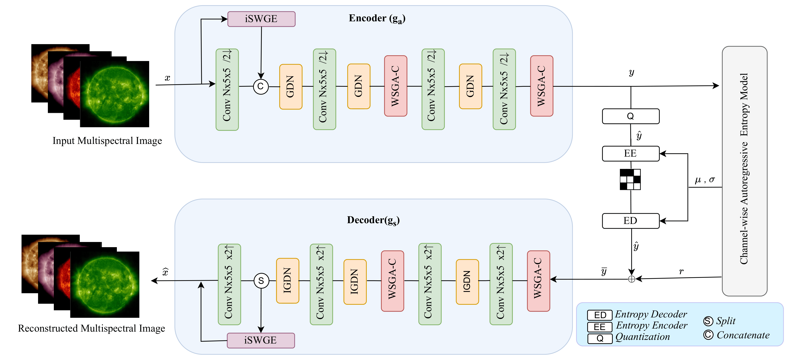
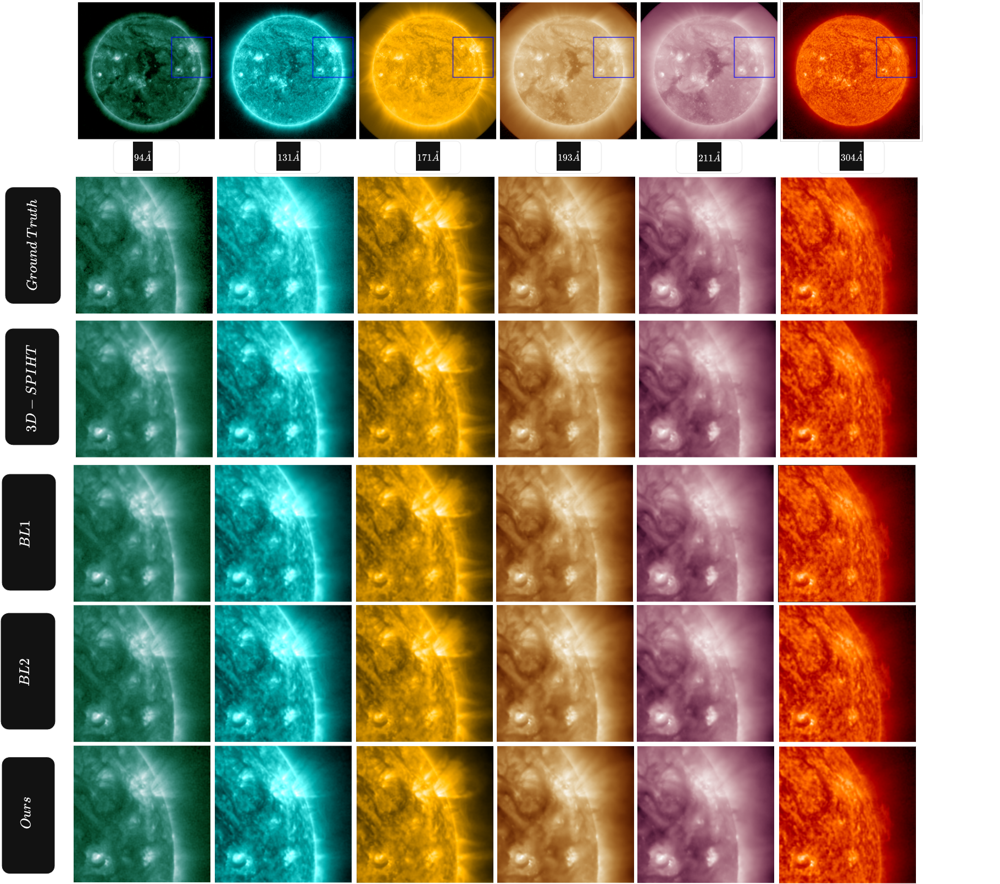

Space missions like NASA's Solar Dynamics Observatory (SDO) produce far more image data than their downlink bandwidth comfortably allows, and the science depends on keeping fine spectral and spatial detail intact. This project is the official PyTorch implementation of our ICMLA 2025 paper, a learned compression framework built specifically for multispectral solar observations.

<!--more-->

## Approach

The model builds on a learned compression pipeline (encoder, channel-wise autoregressive entropy model, decoder) and adds two graph-based modules:

- **Inter-Spectral Windowed Graph Embedding (iSWGE)** treats each spectral channel as a graph node with learned edge features, so relationships between EUV bands are modeled explicitly instead of being mixed implicitly by convolutions.
- **Windowed Spatial Graph Attention + Convolutional Block Attention (WSGA-C)** combines sparse graph attention with convolutional attention to reduce spatial redundancy while emphasizing fine-scale solar structures.

## Results

Evaluated on the SDOML dataset across six extreme ultraviolet channels (94, 131, 171, 193, 211 and 304 Å), at comparable bits-per-pixel the model achieves:

- **20.15% lower** Mean Spectral Information Divergence (MSID)
- up to **1.09% higher** PSNR
- a **1.62% gain** in log-transformed MS-SSIM over strong learned baselines

While the paper focuses on solar EUV imagery, the formulation applies more broadly to multispectral and hyperspectral compression, remote sensing and scientific imaging.

**Publication:** [Spectral and Spatial Graph Learning for Multispectral Solar Image Compression](/publication/solar-image-compression/), ICMLA 2025 ([IEEE Xplore](https://ieeexplore.ieee.org/document/11471480)).
